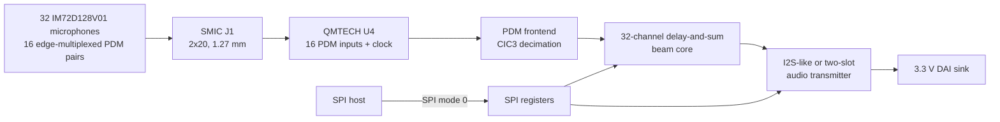
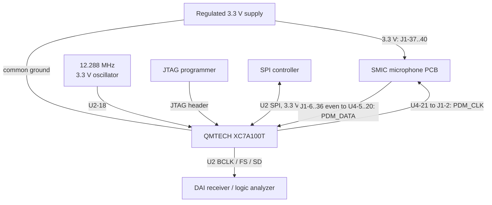

# SMIC — 32-channel PDM microphone array and FPGA beamformer

SMIC is an experimental 32-microphone acoustic array built around Infineon
IM72D128V01 PDM microphones and a QMTECH Artix-7 XC7A100T core board. The
repository contains the circular microphone PCB, FPGA RTL, Vivado automation,
simulation testbenches, a C SPI control library, mechanical files, and the
manufacturer reference documents used for the design.

> [!CAUTION]
> The microphone PCB is not fabrication-ready. Its present copper connects the
> microphone DATA and CLOCK package pins backwards. Do not fabricate the
> existing Gerbers or connect the microphone PCB to the FPGA until this has been
> rerouted and the complete design has passed review. See
> [SMIC PCB design review](Board/smic/docs/DESIGN_REVIEW.md).

The FPGA prototype has been synthesized, implemented, and loaded into an
XC7A100T, but external interfaces and production-quality audio have not received
complete timing, CDC, or laboratory validation.

## System overview

The intended signal chain is:



The FPGA uses a 12.288 MHz external audio reference to generate a 3.072 MHz PDM
clock, 48 kHz PCM samples, and a 3.072 MHz audio bit clock. Each PDM wire carries
two microphones selected on opposite clock edges, giving 32 logical channels
from 16 FPGA inputs.

## Repository layout

| Path | Contents |
|---|---|
| `Board/smic/smic/` | KiCad schematic, PCB, and project files |
| `Board/smic/docs/` | PCB review and exact acoustic-hole coordinates |
| `Board/smic/gerber/` | Historical manufacturing export; currently blocked from fabrication |
| `FPGA/qmtech_beamformer/rtl/` | Synthesizable-intent SystemVerilog |
| `FPGA/qmtech_beamformer/constraints/` | XC7A100T and connector constraints |
| `FPGA/qmtech_beamformer/scripts/` | Vivado project, synthesis, implementation, and programming automation |
| `FPGA/qmtech_beamformer/sim/` | SPI and beam-core testbenches |
| `FPGA/qmtech_beamformer/host/` | C SPI API and steering helper |
| `FPGA/qmtech_beamformer/docs/` | Detailed FPGA integration notes |
| `Doc/` | QMTECH manuals, microphone datasheet, and array-placement drawing |
| `3D/` | FreeCAD mechanical model |

Generated Vivado projects, compatibility libraries, logs, bitstreams, and local
tool state are ignored and should not be committed.

## Current design status

| Area | Status |
|---|---|
| FPGA synthesis/implementation | Completes for `xc7a100tfgg676-1` with Vivado 2026.1 |
| FPGA SRAM programming | Tested through Vivado Hardware Manager/JTAG |
| Behavioral simulations | SPI and beam-core tests pass with Icarus Verilog 12 |
| Microphone hole geometry | Verified against the IM72D128V01 datasheet and NPTH export |
| KiCad PCB DRC | Zero violations and zero unconnected items for the saved, but electrically reversed, net assignment |
| KiCad ERC | Intentionally exposes 32 output-to-output conflicts caused by the DATA/CLOCK reversal |
| Microphone PCB fabrication | **Blocked** pending DATA/CLOCK rerouting and new manufacturing export |
| Audio quality | Prototype only; CIC compensation, anti-alias filtering, and protocol validation remain |
| DDR3 | Not instantiated |

### Not yet supplied

Replication still requires engineering work outside the checked-in artifacts:

- A released purchasing BOM with approved manufacturer part numbers.
- Corrected microphone DATA/CLOCK routing and a new manufacturing package.
- A keyed J1-to-U4 adapter PCB or a fully documented production cable drawing.
- An enclosure, acoustic baffle, wind protection, mounting hardware, and a
  defined microphone-to-surface port geometry.
- Channel calibration data and a host steering implementation based on the
  actual Fermat coordinates.
- Nonvolatile FPGA flash-programming automation.
- Production tests for supply current, J1 continuity, PDM channels, frequency
  response, noise, sensitivity matching, and beam pattern.
- A project license. No license file is currently present, so obtain permission
  before redistribution or commercial use.

## Required hardware

- QMTECH Artix-7 core board V01 with XC7A100T in the FGG676 package. Verify the
  marking on the fitted FPGA; do not assume another QMTECH variant has the same
  pinout.
- A compatible Xilinx/AMD JTAG programmer. The supplied script uses Vivado
  Hardware Manager, not OpenOCD.
- 32 genuine IM72D128V01 microphones and the remaining PCB components after a
  released BOM has been generated and reviewed.
- Regulated 3.3 V microphone-board supply with sufficient margin and a common
  ground with the FPGA.
- Low-jitter 12.288 MHz, 3.3 V clock source for QMTECH U2-18.
- A 3.3 V SPI controller or correctly selected bidirectional level translators.
- A 3.3 V-compatible DAI receiver, codec, logic analyzer, or oscilloscope.
- A keyed adapter/cable between SMIC J1 and QMTECH U4. Do not connect the two
  headers pin-for-pin; use the mapping below.

For bring-up, use a current-limited bench supply and verify every rail and clock
with an oscilloscope before fitting all microphones or attaching the FPGA.

## Hardware connections

### Complete bench wiring



All external interfaces in the current configuration are 3.3 V. QMTECH U2 is
in FPGA bank 15 and cannot be converted to 1.8 V by changing only the XDC
`IOSTANDARD`. A 1.8 V host requires physical translators.

### SMIC J1 to QMTECH U4

The adapter preserves channel order but changes pin numbering:

| Function | SMIC J1 | QMTECH U4 | FPGA pin | RTL port |
|---|---:|---:|---|---|
| PDM clock | 2 | 21 | F2 | `pdm_clk` |
| Pair 1 | 6 | 5 | B5 | `pdm_data[0]` |
| Pair 2 | 8 | 6 | A5 | `pdm_data[1]` |
| Pair 3 | 10 | 7 | B4 | `pdm_data[2]` |
| Pair 4 | 12 | 8 | A4 | `pdm_data[3]` |
| Pair 5 | 14 | 9 | A3 | `pdm_data[4]` |
| Pair 6 | 16 | 10 | A2 | `pdm_data[5]` |
| Pair 7 | 18 | 11 | D4 | `pdm_data[6]` |
| Pair 8 | 20 | 12 | C4 | `pdm_data[7]` |
| Pair 9 | 22 | 13 | C2 | `pdm_data[8]` |
| Pair 10 | 24 | 14 | B2 | `pdm_data[9]` |
| Pair 11 | 26 | 15 | E5 | `pdm_data[10]` |
| Pair 12 | 28 | 16 | D5 | `pdm_data[11]` |
| Pair 13 | 30 | 17 | C1 | `pdm_data[12]` |
| Pair 14 | 32 | 18 | B1 | `pdm_data[13]` |
| Pair 15 | 34 | 19 | E1 | `pdm_data[14]` |
| Pair 16 | 36 | 20 | D1 | `pdm_data[15]` |

J1 odd pins 1 through 35 are ground returns. J1-4 is not connected. J1-37
through J1-40 are the external 3.3 V input. U4 does not supply microphone-board
power: U4-3/4 are VCCO configuration points and U4-63/64 are `VIN`; neither is
an acceptable substitute for the separate regulated microphone supply.

### QMTECH U2: SPI, DAI, reset, and reference clock

| U2 | FPGA pin | Direction at FPGA | Function |
|---:|---|---|---|
| 20 | H21 | Input | SPI SCK |
| 6 | E26 | Input | SPI CS, active-low |
| 7 | D25 | Input | SPI MOSI |
| 8 | E25 | Output | SPI MISO |
| 9 | G26 | Output | Audio BCLK |
| 10 | H26 | Output | Audio frame sync |
| 11 | E23 | Output | Audio serial data |
| 12 | F23 | Input | Reset, active-low; internal pull-up |
| 18 | G20 | Input | External 12.288 MHz reference |

The onboard LEDs are active-low: D5 flashes at 1 Hz while the beamformer is
enabled, and D6 illuminates for at least 100 ms after a complete SPI access.

## Microphone PCB

### Geometry

The PCB is a two-layer, 1.6 mm circular design. The Edge.Cuts source circle is
centered at `(114.205281, 98.532588)` mm. Microphones follow the Fermat layout
shown in `Doc/DMIC_placement.jpeg`.

The IM72D128V01 PG-LLGA-5-3 recommendation uses a 0.8 mm acoustic hole at a
0.68 mm local-X offset from the package origin. The package origins are the
nominal array points, so the true acoustic centers include this rotated offset.
Use [mic_acoustic_holes.csv](Board/smic/docs/mic_acoustic_holes.csv), not the
reference-designator origin, for calibration and beamforming geometry.

### 3.3 V population

For direct compatibility with the FPGA:

- Do not populate U2 (`LP5907MFX-1.8`).
- Populate R18 as 0 ohm to use the existing regulator-bypass path.
- Supply exactly 3.3 V through J1-37..40.
- Never populate U2 and the R18 bypass simultaneously.

U1 is the 74FCT3807S clock fanout. R1 through R17 are 22 ohm series resistors;
the PCB contains 36 nominal 0.1 µF capacitors and two nominal 1 µF capacitors.
These values are a design summary, not a released purchasing BOM. Confirm
manufacturer part numbers, packages, ratings, availability, polarity, assembly
rules, and the exact U1 variant before ordering.

### Required PCB correction

IM72D128V01 physical pin 1 is DATA and pin 3 is CLOCK. The current schematic
and copper connect the clock-fanout branches to pin 1 and paired data routes to
pin 3. Repair requires rerouting each microphone so that:

```text
U1 clock-fanout output  ---> microphone pin 3 (CLOCK)
microphone pin 1 (DATA) ---> paired DATAx net ---> J1 series resistor
```

Do not fix this by merely renaming nets, swapping logical channels, or crossing
the two final traces. Perform a controlled KiCad reroute, refill zones, inspect
the acoustic-port clearances, and rerun ERC/DRC.

### Manufacturing release checklist

1. Fix all 32 DATA/CLOCK connections in both schematic and PCB.
2. Confirm U2 DNP and R18 0-ohm population for 3.3 V operation.
3. Verify J1 orientation, pin-1 marking, cable keying, and ground continuity.
4. Run ERC and resolve every electrical error rather than excluding it.
5. Run PCB DRC after refilling all copper zones.
6. Compare all NPTH acoustic holes with `mic_acoustic_holes.csv`.
7. Inspect solder-mask and paste apertures against the microphone datasheet.
8. Generate and review schematic PDF, BOM, position files, Gerbers, drill files,
   IPC-356/netlist if required, and Gerber job file from one tagged revision.
9. Review the Gerbers in an independent viewer and compare them with KiCad.
10. Fabricate a small pilot batch, inspect it, and electrically test it before a
    production order.

The checked-in `Board/smic/gerber/` directory predates the latest source changes
and must not be sent to a manufacturer.

## FPGA development

### Tool requirements

- AMD/Xilinx Vivado 2026.1 installed at `/opt/AMD_II/2026.1/Vivado`.
- Bash, Tcl, and standard Linux build utilities.
- Icarus Verilog 12 or another SystemVerilog simulator for the included tests.
- `curl`, `sha256sum`, and `dpkg-deb` only if the Ubuntu compatibility setup is
  needed.

To use another Vivado installation, edit `SMIC_VIVADO_ROOT` in
`FPGA/qmtech_beamformer/scripts/run_vivado.sh`.

### Run simulations

From the repository root:

```bash
iverilog -g2012 -s tb_spi -o /tmp/smic_tb_spi \
  FPGA/qmtech_beamformer/rtl/spi_regs.sv \
  FPGA/qmtech_beamformer/sim/tb_spi.sv
vvp /tmp/smic_tb_spi

iverilog -g2012 -s tb_beamformer -o /tmp/smic_tb_beamformer \
  FPGA/qmtech_beamformer/rtl/beam_core.sv \
  FPGA/qmtech_beamformer/sim/tb_beamformer.sv
vvp /tmp/smic_tb_beamformer
```

Both tests should print `PASS`. They cover register writes/commit/access and the
beam-core frame deadline, normalization, and integer delay path; they are not a
complete top-level, PDM, audio-protocol, timing, or CDC verification suite.

### Create, synthesize, and build

```bash
cd FPGA/qmtech_beamformer

# Only if Vivado reports missing legacy ncurses/tinfo libraries:
./scripts/setup_vivado_compat.sh

./scripts/run_vivado.sh -mode batch -source scripts/create_vivado_project.tcl
./scripts/run_vivado.sh -mode batch -source scripts/synthesize.tcl
./scripts/run_vivado.sh -mode batch -source scripts/build_bitstream.tcl
```

Review at least these generated reports before programming:

- `vivado_project/synth_utilization.rpt`
- `vivado_project/synth_timing_summary.rpt`
- `vivado_project/impl_utilization.rpt`
- `vivado_project/impl_timing_summary.rpt`
- `vivado_project/impl_drc.rpt`

The expected bitstream is
`vivado_project/qmtech_beamformer.runs/impl_1/beamformer_top.bit`.

### Program volatile FPGA SRAM

Connect exactly one compatible JTAG target, power the QMTECH board, then run:

```bash
cd FPGA/qmtech_beamformer
./scripts/run_vivado.sh -mode batch -source scripts/program_device.tcl
```

The script enumerates the chain, requires exactly one XC7A100T, programs the
bitstream, and reports DONE when that property is available. Programming is
volatile and is lost when power is removed. Configuration-flash programming is
not implemented in this repository.

## Operating the beamformer

### SPI protocol

- Mode 0.
- Keep SCK below 2 MHz for the current asynchronous capture implementation.
- Deassert CS between transactions.
- Each transaction is exactly seven bytes:

```text
byte 0       byte 1..2             byte 3..6
opcode       16-bit address        32-bit data
0x02 write   big-endian            big-endian
0x03 read    big-endian            returned big-endian
```

The host transfer callback must hold CS active for all seven bytes.

### Important registers

| Address | Name | Description |
|---:|---|---|
| `0x0000` | ID | Read-only, expected `0xBF320001` |
| `0x0004` | CTRL | Bit 0 enable, bit 1 mute |
| `0x0008` | STATUS | Placeholder |
| `0x000C` | SAMPLE_RATE | Read-only 48000 |
| `0x0010` | MODE | Bit 1 selects two-slot TDM-like output |
| `0x0014` | AZIMUTH | Reserved; host currently calculates delays |
| `0x0018` | ELEVATION | Reserved; host currently calculates delays |
| `0x001C` | OUTPUT_GAIN | Q1.15 |
| `0x0020` | ENABLE_MASK | One bit per microphone |
| `0x0024` | COMMIT | Write bit 0 to activate shadow delays/gains |
| `0x0028` | FRAME_COUNT | Output frame counter |
| `0x002C` | ERRORS | Placeholder |
| `0x0100 + 4*i` | DELAY[i] | Q16.16 samples, integer part limited to 254 |
| `0x0200 + 4*i` | GAIN[i] | Q1.15 microphone gain |
| `0x0300 + 4*i` | LEVEL[i] | Per-channel level |

### C host API

Implement `bf_spi_transfer`, initialize a `bf_device`, and call:

```c
bf_device dev = {
    .transfer = platform_spi_transfer,
    .ctx = &platform_context,
};

bf_init(&dev, array_radius_m);
bf_set_direction(&dev, azimuth_deg, elevation_deg);
bf_start(&dev);
```

The current `bf_set_direction()` helper assumes 32 microphones uniformly spaced
on a perfect circle. The PCB uses a Fermat spiral, so this helper does not model
the actual hardware. Before acoustic use, replace its generated coordinates
with the positions in `Board/smic/docs/mic_acoustic_holes.csv`, convert KiCad Y
to the chosen acoustic coordinate convention, and calibrate per-channel delay,
gain, polarity, and channel order.

### Audio output

The output uses 64 bit clocks per 48 kHz frame. Mode bit 1 selects between an
I2S-like framing mode and a TDM-like two-slot mode. Only one mono beam is emitted
in slot 0; slot 1 is zero. Validate BCLK, frame-sync polarity, sample alignment,
and one-bit I2S delay against the actual receiver before relying on the stream.

## Signal-processing architecture and limitations

- PDM decimation is CIC3 at a factor of 64. It requires a compensation and
  anti-alias FIR for production-quality audio.
- The beamformer uses a time-multiplexed 8192x24 history memory and completes a
  frame in 195 of the 256 available 12.288 MHz clocks.
- Fractional delay uses an initial linear method; a verified higher-quality
  interpolator is still required.
- There is no AEC, AGC, automatic microphone calibration, MVDR, source tracking,
  or multiple simultaneous beams.
- The planar array cannot uniquely resolve elevation sign and may exhibit
  front/back ambiguity depending on its acoustic mounting.
- External I/O delays and complete CDC constraints are not signed off.
- DDR3 is intentionally unused because the present history is only 24 KiB.
  DDR3 is a future option for capture buffers, longer delays, diagnostics, or
  multiple beams and requires a board-specific MIG configuration.

## Bring-up sequence

1. Correct and manufacture a reviewed microphone PCB; do not use the current
   historical Gerbers.
2. With U2 absent and R18 fitted, power only the microphone PCB from a
   current-limited 3.3 V supply. Verify resistance-to-ground before power and
   then verify the rail at U1 and several microphones.
3. Apply the PDM clock independently and confirm all fanout outputs before
   attaching the FPGA data inputs.
4. Verify J1 pin 1, cable orientation, and every continuity path to U4.
5. Program the FPGA with the microphone PCB disconnected and confirm D5/D6,
   SPI ID access, clock, reset, and DAI outputs.
6. Connect one microphone pair first. Confirm clock amplitude, DATA high-Z edge
   behavior, channel polarity, and PCM activity.
7. Add the remaining pairs while monitoring supply current and signal integrity.
8. Measure channel order using a local acoustic stimulus and compare it with the
   CSV geometry before enabling beam steering.
9. Capture known signals, check clipping/noise/CIC droop, and calibrate gain and
   delay before evaluating beam patterns.

## Primary references

- [FPGA integration and limitations](FPGA/qmtech_beamformer/docs/INTEGRATION.md)
- [Microphone PCB review](Board/smic/docs/DESIGN_REVIEW.md)
- [Exact acoustic-hole coordinates](Board/smic/docs/mic_acoustic_holes.csv)
- `Doc/infineon_im72d128_datasheet_en.pdf`
- `Doc/QMTECH_Artix-7_XC7A100T_Core_Board_User_Manual(Hardware)_V01.pdf`
- `Doc/QMTECH_XC7A75T_100T_200T-CORE-BOARD-V01-20210109.pdf`

Before changing connector assignments, voltage levels, the FPGA part, or the
microphone footprint, recheck the original manufacturer documents rather than
copying values from this README alone.
