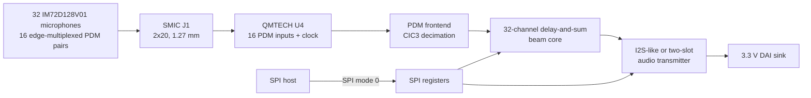
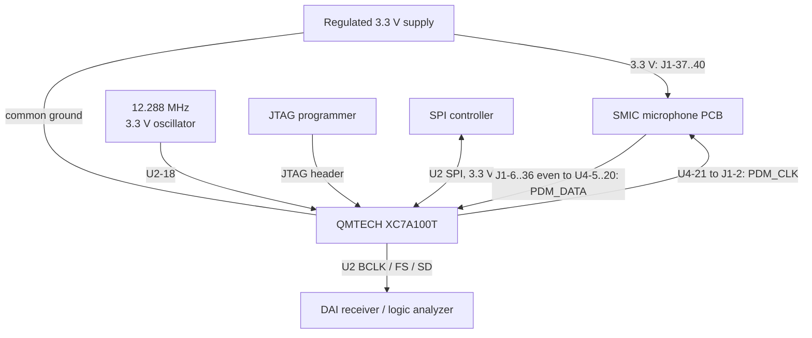

# SMIC — 32-channel PDM microphone array and FPGA beamformer

SMIC is an experimental 32-microphone acoustic array built around Infineon
IM72D128V01 PDM microphones and a QMTECH Artix-7 XC7A100T core board. The
repository contains the circular microphone PCB, FPGA RTL, Vivado automation,
simulation testbenches, a C SPI control library, mechanical files, and the
manufacturer reference documents used for the design.

> [!CAUTION]
> The microphone PCB is fully routed, but it is not production-ready. KiCad
> 10.0.8 reports 19 ERC errors, one ERC warning, 32 DRC errors, and 15 DRC
> warnings. The current Gerbers represent the routed geometry but must not be
> fabricated until the footprint, sound-port clearance, bypassing, power/ground
> layout, BOM, and manufacturing release gates are resolved. See
> [SMIC PCB design review](Board/smic/docs/DESIGN_REVIEW.md).

The FPGA prototype has been synthesized, implemented, and loaded into an
XC7A100T, but external interfaces and production-quality audio have not received
complete timing, CDC, or laboratory validation.

## System overview

The intended signal chain is:



The FPGA uses a 12.288 MHz external audio reference to generate a 3.072 MHz PDM
clock, 48 kHz PCM samples, and a 3.072 MHz audio bit clock. Each PDM wire carries
two microphones selected on opposite clock edges, giving 32 logical channels
from 16 FPGA inputs.

## Repository layout

| Path | Contents |
|---|---|
| `Board/smic/smic/` | KiCad schematic, PCB, and project files |
| `Board/smic/docs/` | PCB review and exact acoustic-hole coordinates |
| `Board/smic/smic/Gerber/` | Current Gerber/drill export; blocked from fabrication by the design review |
| `FPGA/qmtech_beamformer/rtl/` | Synthesizable-intent SystemVerilog |
| `FPGA/qmtech_beamformer/constraints/` | XC7A100T and connector constraints |
| `FPGA/qmtech_beamformer/scripts/` | Vivado project, synthesis, implementation, and programming automation |
| `FPGA/qmtech_beamformer/sim/` | SPI and beam-core testbenches |
| `FPGA/qmtech_beamformer/host/` | C SPI API and steering helper |
| `FPGA/qmtech_beamformer/docs/` | Detailed FPGA integration notes |
| `Doc/` | QMTECH manuals, microphone datasheet, and array-placement drawing |
| `3D/` | FreeCAD enclosure model and SMIC Experiment workbench |

Generated Vivado projects, compatibility libraries, logs, bitstreams, and local
tool state are ignored and should not be committed.

## Current design status

| Area | Status |
|---|---|
| FPGA synthesis/implementation | Completes for `xc7a100tfgg676-1` with Vivado 2026.1 |
| FPGA SRAM programming | Tested through Vivado Hardware Manager/JTAG |
| FPGA configuration flash | N25Q064A SPIx4 erase/program/verify and flash boot tested; DONE=1 |
| Behavioral simulations | SPI and beam-core tests pass with Icarus Verilog 12 |
| Microphone hole geometry | All 32 NPTHs and back-silkscreen circles match the coordinate CSV |
| Microphone schematic nets | Pin 1 DATA, pin 3 CLOCK, and complementary SELECT pairing verified by source inspection |
| KiCad PCB routing | Fully connected: 954 segments, 287 through vias, three zones, and zero unconnected pads |
| KiCad ERC | **Fail:** 19 errors and one warning; paired PDM outputs need tri-state modeling, power intent and J1 NC need annotation, and the local U1 symbol library is unresolved |
| KiCad DRC | **Fail:** 32 microphone NPTH-to-pad clearance errors and 15 footprint-library mismatch warnings; zero unrouted items |
| Microphone PCB fabrication | **Blocked** pending footprint/clearance resolution, required bypassing, return-path review, released BOM/variant, clean checks, and complete manufacturing output |
| Audio quality | Prototype only; CIC compensation, anti-alias filtering, and protocol validation remain |
| DDR3 | Not instantiated |

## Experimental enclosure

[`3D/main_body.FCStd`](3D/main_body.FCStd) contains a derived
`SMICExperimentalBody` with a 6 mm-pitch internal thread spanning Z=0.8–49.2
mm. The original lower ledge is opened to the 128.4 mm threaded bore so a
bottom cap and separate threaded board-carrier rings can enter from either end.
The exterior uses 24 rounded vertical ribs as an initial wave texture.

The installed **SMIC Experiment** FreeCAD workbench makes the thread pitch,
depth, bore, axial range, bottom opening, and exterior wave count/radius/range
adjustable. Its checked-in source and installation instructions are in
[`3D/FreeCAD/Mod/SMIC_Experiment/`](3D/FreeCAD/Mod/SMIC_Experiment/README.md).
The generated body is a separate feature, leaving the original Part Design
body available for further edits.

[`3D/internal_ring_10mm.FCStd`](3D/internal_ring_10mm.FCStd) is a compatible
10 mm-high carrier ring with a 124 mm opening and 6 mm-pitch male thread. Its
128.0/132.0 mm minor/major diameters provide 0.2 mm radial clearance from the
body on each side, and each thread flank has an additional 0.2 mm axial
printing clearance. The aligned FreeCAD solids have zero interference. The
reproducible generator is [`3D/create_internal_ring.py`](3D/create_internal_ring.py).

### Not yet supplied

Replication still requires engineering work outside the checked-in artifacts:

- A released purchasing BOM with approved manufacturer part numbers.
- A production-reviewed microphone PCB: the current board is routed, but its
  ERC/DRC, microphone footprint, bypassing, return paths, and manufacturing
  package are not released.
- A keyed J1-to-U4 adapter PCB or a fully documented production cable drawing.
- A released enclosure, acoustic baffle, wind protection, mounting hardware,
  and a defined microphone-to-surface port geometry. The checked-in enclosure
  is an adjustable mechanical prototype, not a production release.
- Channel calibration data and a host steering implementation based on the
  actual Fermat coordinates.
- Production tests for supply current, J1 continuity, PDM channels, frequency
  response, noise, sensitivity matching, and beam pattern.
- A project license. No license file is currently present, so obtain permission
  before redistribution or commercial use.

## Required hardware

- QMTECH Artix-7 core board V01 with XC7A100T in the FGG676 package. Verify the
  marking on the fitted FPGA; do not assume another QMTECH variant has the same
  pinout.
- A compatible Xilinx/AMD JTAG programmer. The supplied script uses Vivado
  Hardware Manager, not OpenOCD.
- 32 genuine IM72D128V01 microphones and the remaining PCB components after a
  released BOM has been generated and reviewed.
- Regulated 3.3 V microphone-board supply with sufficient margin and a common
  ground with the FPGA.
- Low-jitter 12.288 MHz, 3.3 V clock source for QMTECH U2-18.
- A 3.3 V SPI controller or correctly selected bidirectional level translators.
- A 3.3 V-compatible DAI receiver, codec, logic analyzer, or oscilloscope.
- A keyed adapter/cable between SMIC J1 and QMTECH U4. Do not connect the two
  headers pin-for-pin; use the mapping below.

For bring-up, use a current-limited bench supply and verify every rail and clock
with an oscilloscope before fitting all microphones or attaching the FPGA.

## Hardware connections

### Complete bench wiring



All external interfaces in the current configuration are 3.3 V. QMTECH U2 is
in FPGA bank 15 and cannot be converted to 1.8 V by changing only the XDC
`IOSTANDARD`. A 1.8 V host requires physical translators.

### SMIC J1 to QMTECH U4

The adapter preserves channel order but changes pin numbering:

| Function | SMIC J1 | QMTECH U4 | FPGA pin | RTL port |
|---|---:|---:|---|---|
| PDM clock | 2 | 21 | F2 | `pdm_clk` |
| Pair 1 | 6 | 5 | B5 | `pdm_data[0]` |
| Pair 2 | 8 | 6 | A5 | `pdm_data[1]` |
| Pair 3 | 10 | 7 | B4 | `pdm_data[2]` |
| Pair 4 | 12 | 8 | A4 | `pdm_data[3]` |
| Pair 5 | 14 | 9 | A3 | `pdm_data[4]` |
| Pair 6 | 16 | 10 | A2 | `pdm_data[5]` |
| Pair 7 | 18 | 11 | D4 | `pdm_data[6]` |
| Pair 8 | 20 | 12 | C4 | `pdm_data[7]` |
| Pair 9 | 22 | 13 | C2 | `pdm_data[8]` |
| Pair 10 | 24 | 14 | B2 | `pdm_data[9]` |
| Pair 11 | 26 | 15 | E5 | `pdm_data[10]` |
| Pair 12 | 28 | 16 | D5 | `pdm_data[11]` |
| Pair 13 | 30 | 17 | C1 | `pdm_data[12]` |
| Pair 14 | 32 | 18 | B1 | `pdm_data[13]` |
| Pair 15 | 34 | 19 | E1 | `pdm_data[14]` |
| Pair 16 | 36 | 20 | D1 | `pdm_data[15]` |

J1 odd pins 1 through 35 are ground returns. J1-4 is not connected. J1-37
through J1-40 are the external 3.3 V input. U4 does not supply microphone-board
power: U4-3/4 are VCCO configuration points and U4-63/64 are `VIN`; neither is
an acceptable substitute for the separate regulated microphone supply.

### QMTECH U2: SPI, DAI, reset, and reference clock

| U2 | FPGA pin | Direction at FPGA | Function |
|---:|---|---|---|
| 20 | H21 | Input | SPI SCK |
| 6 | E26 | Input | SPI CS, active-low |
| 7 | D25 | Input | SPI MOSI |
| 8 | E25 | Output | SPI MISO |
| 9 | G26 | Output | Audio BCLK |
| 10 | H26 | Output | Audio frame sync |
| 11 | E23 | Output | Audio serial data |
| 12 | F23 | Input | Reset, active-low; internal pull-up |
| 18 | G20 | Input | External 12.288 MHz reference |

The onboard LEDs are active-low: D5 flashes at 1 Hz while the beamformer is
enabled, and D6 illuminates for at least 100 ms after a complete SPI access.

## Microphone PCB

### Geometry

The PCB is a two-layer, 1.6 mm circular design. The Edge.Cuts source circle is
centered at `(114.205281, 98.532588)` mm. Microphones follow the Fermat layout
shown in `Doc/DMIC_placement.jpeg`.

The IM72D128V01 PG-LLGA-5-3 recommendation uses a 0.8 mm acoustic hole at a
0.68 mm local-X offset from the package origin. Each package origin is shifted
to put its actual NPTH on the nominal Fermat point, and every DMIC body is
horizontal or vertical. All 32 NPTHs and their back-silkscreen circles match
[mic_acoustic_holes.csv](Board/smic/docs/mic_acoustic_holes.csv). Use those CSV
coordinates, not reference-designator origins, for calibration and beamforming.

### 3.3 V population

For direct compatibility with the FPGA:

- Do not populate U2 (`LP5907MFX-1.8`).
- Populate R18 as 0 ohm to use the existing regulator-bypass path.
- Supply exactly 3.3 V through J1-37..40.
- Never populate U2 and the R18 bypass simultaneously.

U1 is the 74FCT3807S clock fanout. R1 through R17 are 22 ohm series resistors;
the PCB contains 36 nominal 0.1 µF capacitors and two nominal 1 µF capacitors.
These values are a design summary, not a released purchasing BOM. Confirm
manufacturer part numbers, packages, ratings, availability, polarity, assembly
rules, and the exact U1 variant before ordering.

The two 1 µF parts do not satisfy the microphone datasheet's instruction to
place a 1 µF bypass capacitor close to each microphone VDD pad. This and the
U1 decoupling placement are production blockers, even though all power nets are
routed. The 74FCT3807S family supports 3.3 V, but an exact orderable TSSOP-20
part number must be selected.

### Current PCB review and required work

The current schematic-derived net assignments correctly connect IM72D128V01
pin 1 to paired DATA nets and pin 3 to U1 clock branches. Each of the 16 DATA
nets has two microphones with complementary SELECT straps. All ten U1 outputs
are used. The PCB has 954 track segments and 287 through vias, and KiCad reports
zero unconnected pads after zone refill.

Connectivity is not a production sign-off. KiCad 10.0.8 currently reports 19
ERC errors plus one warning and 32 DRC errors plus 15 warnings. The DRC errors
are the 0.18 mm copper-to-acoustic-NPTH clearance at all 32 microphones versus
the configured 0.25 mm minimum. The warnings are local microphone-footprint
library mismatches. The generated Gerbers and drills reflect this blocked
design and must not be ordered.

The detailed [schematic and PCB review](Board/smic/docs/DESIGN_REVIEW.md)
prioritizes these revisions before production release:

- create and freeze the correct project-local PG-LLGA-5-3 microphone footprint,
  then resolve the 32 acoustic-hole clearance errors with the fabricator;
- add the required 1 µF local bypassing at every microphone and move U1's four
  local capacitors directly to its supply/ground pairs;
- model the paired PDM outputs as tri-state, annotate power and no-connect
  intent, fix the missing local symbol-library mapping, and obtain clean ERC;
- preserve a continuous ground return, preferably with a four-layer stackup,
  instead of relying on the split B.Cu GND/3.3 V plane and stitching vias;
- review all ten clock branches, test-point stubs, and optional source damping
  using oscilloscope measurements rather than connectivity alone;
- add connector-side bulk capacitance and optional filtering/protection;
- key the board-to-FPGA interconnect and improve test access;
- add assembly fiducials plus enclosure-compatible mounting/tooling features;
- add a board revision, voltage/variant markings, approved MPNs, position files,
  and fabrication/assembly drawings.

These are design recommendations, not implemented hardware changes. Reassess
component placement and acoustic cavities against the enclosure before release.

### Manufacturing release checklist

1. Freeze the exact 3.3 V assembly variant, MPNs, project-local symbol library,
   and corrected PG-LLGA-5-3 footprint.
2. Add the required microphone/U1 bypassing and approve power/ground return
   paths, clock routing, connector protection, fiducials, and mechanics.
3. Resolve ERC by modeling real electrical intent; do not broadly exclude the
   paired PDM output errors.
4. Resolve every microphone hole-clearance finding with the fabricator, remove
   stale exclusions, refill zones, and obtain reviewed clean ERC/DRC results.
5. Re-verify J1 mapping, SELECT polarity, all clock destinations, and every
   acoustic NPTH against `mic_acoustic_holes.csv`.
6. Inspect solder-mask and paste apertures against the microphone datasheet.
7. Add revision/voltage/variant markings and complete fabrication, assembly,
   acoustic-port handling, and test specifications.
8. Generate schematic PDF, released BOM, position files, Gerbers, drills,
   Gerber job, and optional IPC-356 from one tagged revision.
9. Review all outputs in an independent viewer and compare their netlist and
   drill counts with the KiCad source.
10. Fabricate a small pilot batch, inspect ports and reflow, and test supply,
    clocks, all 16 PDM pairs, channel order, noise, calibration, and beam pattern
    before authorizing production quantity.

The checked-in `Board/smic/smic/Gerber/` directory was regenerated from the
current routed board, but it is explicitly blocked by the findings above and
must not yet be sent to a manufacturer.

## FPGA development

### Tool requirements

- AMD/Xilinx Vivado 2026.1 installed at `/opt/AMD_II/2026.1/Vivado`.
- Bash, Tcl, and standard Linux build utilities.
- Icarus Verilog 12 or another SystemVerilog simulator for the included tests.
- `curl`, `sha256sum`, and `dpkg-deb` only if the Ubuntu compatibility setup is
  needed.

To use another Vivado installation, edit `SMIC_VIVADO_ROOT` in
`FPGA/qmtech_beamformer/scripts/run_vivado.sh`.

### Run simulations

From the repository root:

```bash
iverilog -g2012 -s tb_spi -o /tmp/smic_tb_spi \
  FPGA/qmtech_beamformer/rtl/spi_regs.sv \
  FPGA/qmtech_beamformer/sim/tb_spi.sv
vvp /tmp/smic_tb_spi

iverilog -g2012 -s tb_beamformer -o /tmp/smic_tb_beamformer \
  FPGA/qmtech_beamformer/rtl/beam_core.sv \
  FPGA/qmtech_beamformer/sim/tb_beamformer.sv
vvp /tmp/smic_tb_beamformer
```

Both tests should print `PASS`. They cover register writes/commit/access and the
beam-core frame deadline, normalization, and integer delay path; they are not a
complete top-level, PDM, audio-protocol, timing, or CDC verification suite.

### Create, synthesize, and build

```bash
cd FPGA/qmtech_beamformer

# Only if Vivado reports missing legacy ncurses/tinfo libraries:
./scripts/setup_vivado_compat.sh

./scripts/run_vivado.sh -mode batch -source scripts/create_vivado_project.tcl
./scripts/run_vivado.sh -mode batch -source scripts/synthesize.tcl
./scripts/run_vivado.sh -mode batch -source scripts/build_bitstream.tcl
```

Review at least these generated reports before programming:

- `vivado_project/synth_utilization.rpt`
- `vivado_project/synth_timing_summary.rpt`
- `vivado_project/impl_utilization.rpt`
- `vivado_project/impl_timing_summary.rpt`
- `vivado_project/impl_drc.rpt`

The expected bitstream is
`vivado_project/qmtech_beamformer.runs/impl_1/beamformer_top.bit`.

### Program volatile FPGA SRAM

Connect exactly one compatible JTAG target, power the QMTECH board, then run:

```bash
cd FPGA/qmtech_beamformer
./scripts/run_vivado.sh -mode batch -source scripts/program_device.tcl
```

The script enumerates the chain, requires exactly one XC7A100T, programs the
bitstream, and reports DONE when that property is available. Programming is
volatile and is lost when power is removed.

### Program nonvolatile configuration flash

The QMTECH V01 board uses a 3.3 V Micron N25Q064A, 64 Mbit configuration flash.
The checked-in constraints generate a Master-SPIx4 bitstream matching the
board's `M[2:0]=100` boot straps. To replace the board's power-on image:

```bash
cd FPGA/qmtech_beamformer
./scripts/run_vivado.sh -mode batch -source scripts/generate_cfgmem.tcl
./scripts/run_vivado.sh -mode batch -source scripts/program_cfgmem.tcl
```

The programming script requires exactly one XC7A100T, loads Vivado's temporary
SPI bridge, erases the existing flash image, programs the MCS file, performs a
read-back verification, and boots the FPGA from flash. On 2026-11-15 the board
reported JEDEC ID `20 BA 17`, program/verify completed successfully, and the
flash-booted FPGA reported `DONE=1`.

## Operating the beamformer

### SPI protocol

- Use **SPI mode 0**: `CPOL=0`, `CPHA=0`. SCK idles low; the FPGA samples
  MOSI on rising edges and the host samples MISO on rising edges. Change data
  on falling edges.
- Use MSB first and keep SCK at or below 2 MHz. This conservative limit is for
  the current SCK-to-12.288-MHz toggle synchronizer, not the FPGA I/O limit.
- `CS_N` is active low. Hold it low for exactly 56 clocks and return it high
  between commands. MISO is high-impedance while `CS_N` is high, so the bus may
  be shared.
- Every command is exactly seven bytes:

```text
byte 0       byte 1..2             byte 3..6
opcode       16-bit address        32-bit data
0x02 write   big-endian            big-endian
0x03 read    big-endian            returned big-endian
```

For a write, opcode `0x02` is followed by the address and value. For a read,
send opcode `0x03`, the address, and four dummy bytes; the returned value is in
receive bytes 3 through 6. A command is accepted only after all 56 bits arrive.
The host transfer callback must keep `CS_N` active across the whole seven-byte
exchange and must not split it into separate opcode/address/data transfers.

Register writes cross asynchronously into the audio clock domain and normally
become visible within three 12.288 MHz clocks. Delay, gain, and polarity writes
go to shadow registers; writing `COMMIT.bit0=1` copies the complete set into the
beamformer together. Readback of those fields reports the shadow value. D6 is
held on for about 100 ms after every valid read or write transaction.

### Important registers

| Address | Name | Description |
|---:|---|---|
| `0x0000` | ID | Read-only, expected `0xBF320001` |
| `0x0004` | CTRL | Bit 0 enable, bit 1 mute |
| `0x0008` | STATUS | Placeholder |
| `0x000C` | SAMPLE_RATE | Read-only 48000 |
| `0x0010` | MODE | Bit 1 selects two-slot TDM-like output |
| `0x0014` | AZIMUTH | Reserved; host currently calculates delays |
| `0x0018` | ELEVATION | Reserved; host currently calculates delays |
| `0x001C` | OUTPUT_GAIN | Q1.15 |
| `0x0020` | ENABLE_MASK | One bit per microphone |
| `0x0024` | COMMIT | Write bit 0 to activate shadow delays, gains, and polarity |
| `0x0028` | FRAME_COUNT | Output frame counter |
| `0x002C` | ERRORS | Placeholder |
| `0x0030` | TEST_CONTROL | Test-source enable, routing, and pattern |
| `0x0034` | TEST_AMPLITUDE | Signed 24-bit synthetic PCM amplitude |
| `0x0038` | POLARITY_MASK | One invert bit per channel; shadowed by `COMMIT` |
| `0x0100 + 4*i` | DELAY[i] | Q16.16 samples, integer part limited to 254 |
| `0x0200 + 4*i` | GAIN[i] | Q1.15 microphone gain |
| `0x0300 + 4*i` | LEVEL[i] | Per-channel level |

`MODE.bit1` selects the two-slot TDM-like transmitter; zero selects I2S-like
framing. All other `MODE` bits are reserved and should be written as zero.
`OUTPUT_GAIN` and `GAIN[i]` use unsigned Q1.15 (`0x8000` = 1.0). Values up to
`0xFFFF` are valid, although headroom must be allowed to avoid output clipping.
Only `TEST_AMPLITUDE[23:0]` is used and it is interpreted as signed two's
complement; bits 31:24 are ignored and should be written as zero.
`LEVEL[i]` is the absolute magnitude of the most recently accepted PCM sample,
not RMS or peak-hold metering.

`TEST_CONTROL` is defined as follows:

| Bits | Meaning |
|---:|---|
| 0 | Enable synthetic PCM and bypass the PDM samples |
| 1 | Send the test signal to all channels; if zero, use the selected channel |
| 6:2 | Selected channel, 0 through 31 |
| 9:8 | Pattern: 0 = 1 kHz square, 1 = 1 kHz impulse train, 2 = DC, 3 = alternating samples (24 kHz) |
| Other | Reserved, write zero |

When test mode is enabled, unselected channels are forced to zero. The source
enters after PDM decimation but before history, fractional delay, calibration,
summation, and audio transmission. It therefore tests the beamformer and output
path, but does **not** test microphones, PDM wiring, CIC decimation, or acoustic
channel order.

### C host API

Implement `bf_spi_transfer`, initialize a `bf_device`, and call:

```c
bf_device dev = {
    .transfer = platform_spi_transfer,
    .ctx = &platform_context,
};

bf_init(&dev, array_radius_m);
bf_set_geometry(&dev, measured_positions);
bf_set_calibration(&dev, measured_calibration);
bf_set_direction(&dev, azimuth_deg, elevation_deg);
bf_start(&dev);
```

`bf_init()` supplies a circular fallback geometry only. The PCB is a Fermat
spiral, so production software must build a 32-element `bf_mic_position` array
from `Board/smic/docs/mic_acoustic_holes.csv`, convert millimetres to metres,
subtract the array centre, choose whether acoustic +Y is KiCad +Y or -Y, and
call `bf_set_geometry()`. The `MKn` number is treated as channel `n-1` by the
heatmap tool, but that assumption must be verified against the physical PDM
pair/edge channel order before use.

The host library stores per-channel gain, delay correction, and polarity in
`bf_mic_calibration`. `bf_set_direction()` combines those values with geometric
steering, writes all shadow registers, writes the polarity mask, then commits
the set. These values are volatile: reload geometry and calibration after every
FPGA reset or power cycle.

### Steering mathematics

Angles use degrees. Azimuth is measured in the array XY plane from +X toward
+Y; elevation is measured from the XY plane toward +Z. The look-direction unit
vector is

```text
u = [cos(el) cos(az), cos(el) sin(az), sin(el)].
```

For microphone position `r_i=[x_i,y_i,z_i]`, sample rate `Fs=48000`, and speed
of sound `c` (343 m/s by default), the host first calculates

```text
p_i       = dot(r_i, u)
raw_i     = -Fs * p_i / c + calibration_delay_i
d_i       = raw_i - min(raw_0 ... raw_31)
DELAY[i]  = round(65536 * d_i)
GAIN[i]   = round(32768 * calibration_gain_i)
```

Subtracting the common minimum makes every hardware delay non-negative without
changing relative phase. `d_i` must be at most 254 samples. At 48 kHz that is
5.29 ms, much longer than the geometric delay across this PCB. Temperature
changes `c`; for tighter steering, use approximately
`c = 331.3 + 0.606*T_C` m/s or a measured local value.

Inside `beam_core.sv`, the integer and fractional portions select two adjacent
history samples. With `f=DELAY[i][15:0]/65536`, interpolation is

```text
x_i' = (1-f) * history_i[n-floor(d_i)]
       + f * history_i[n-floor(d_i)-1]
y    = OUTPUT_GAIN * (sum(enabled_i * polarity_i * GAIN[i] * x_i') / N)
```

`N` is the number of enabled microphones and division uses a Q0.24 reciprocal
lookup table. The final value is saturated to signed 24-bit PCM. Linear
interpolation is inexpensive but its high-frequency magnitude/phase error is
larger than a Farrow or windowed-sinc fractional-delay filter.

### Beam heatmap

The FPGA produces one audio beam; it does not render or scan a heatmap. The
far-field prediction is implemented on the host in
[`beam_heatmap.py`](FPGA/qmtech_beamformer/host/beam_heatmap.py). It uses the
actual acoustic-hole coordinates, the same steering-delay equation, optional
calibration, and the narrow-band array factor at a chosen frequency. Run:

```bash
python3 FPGA/qmtech_beamformer/host/beam_heatmap.py \
  --geometry Board/smic/docs/mic_acoustic_holes.csv \
  --calibration FPGA/qmtech_beamformer/host/calibration.example.csv \
  --frequency 3000 --steer-az 45 --steer-el 0 \
  --output /tmp/smic_3khz
```

This writes `/tmp/smic_3khz.csv` in dB and a directly viewable
`/tmp/smic_3khz.svg`. By default KiCad Y is negated so +Y points upward in a
top-view Cartesian plot; pass `--keep-kicad-y` to retain KiCad's Y direction.
The result is a theoretical free-field map, not measured acoustic performance:
it omits enclosure diffraction, microphone directivity, tolerances, reflections,
and the CIC response. A broadband beam must be assessed at several frequencies.

### Digital test mode

Use test mode before attaching the microphone PCB to check SPI, shadow commits,
delay/gain/polarity processing, DAI, and the receiver:

```c
/* 0x040000 is about -30 dBFS in signed 24-bit PCM. */
bf_set_test_mode(&dev, BF_TEST_SQUARE_1KHZ, 0, 1, 0x040000);
bf_start(&dev);
/* Inspect audio output, then always return to real PDM input. */
bf_disable_test_mode(&dev);
```

With `all_channels=1` and zero delays, output amplitude should equal the test
amplitude because the core normalizes by enabled-channel count. Select a single
channel and set `ENABLE_MASK` to the same one bit to test that channel's delay,
gain, and polarity without the other 31 zeros reducing the result. The impulse
pattern is useful for confirming integer/fractional delay. DC is intended for
short datapath checks and should not be sent to speakers at high amplitude.

### Microphone calibration guide

Calibration support is manual/offline; the design does not yet estimate
coefficients automatically. A practical procedure is:

1. Verify channel order first with a close sound source at each microphone.
   Record the FPGA channel corresponding to every `MKn`; do not infer it only
   from connector numbering or shared PDM data pairs.
2. Place the completed array and a reference loudspeaker in a low-reflection
   setup, aimed normal to the PCB and far enough away that path differences are
   small. Keep source, gain, and geometry fixed.
3. Capture every decimated microphone channel using an FPGA diagnostic build or
   external logic. The current mono audio output and instantaneous `LEVEL[i]`
   registers are not sufficient for accurate phase calibration.
4. Play a band-limited sweep or maximum-length sequence. Estimate relative lag
   by cross-correlation around the expected geometric lag. Choose a reference
   channel and store each residual in `delay_samples`; fractional values are
   supported.
5. Compare RMS amplitudes over the same steady segment. Set
   `gain_linear_i = target_rms / measured_rms_i`, then reduce all gains by a
   common factor if any would reach 2.0. Use `invert=1` only when correlation
   shows a true 180-degree polarity reversal.
6. Save 32 rows using the format in
   [`calibration.example.csv`](FPGA/qmtech_beamformer/host/calibration.example.csv),
   load them into `bf_mic_calibration`, call `bf_set_calibration()`, and then
   call `bf_set_direction()` to write and commit the combined coefficients.
7. Repeat the measurement from several directions and across the operating
   band. A delay that changes strongly with frequency indicates acoustic or
   filter mismatch that a single delay/gain coefficient cannot correct.

Calibration delay is a correction applied by the FPGA. If a channel is measured
late by `q` samples, store approximately `-q` for that channel; removal of the
common minimum then delays the other channels by the equivalent amount. If it
is early by `q`, store approximately `+q`. Confirm this sign convention with an
impulse or correlation before saving coefficients. Negative values are accepted
as long as the final relative delays fit the 254-sample history limit.

### Audio output

The output uses 64 bit clocks per 48 kHz frame. Mode bit 1 selects between an
I2S-like framing mode and a TDM-like two-slot mode. Only one mono beam is emitted
in slot 0; slot 1 is zero. Validate BCLK, frame-sync polarity, sample alignment,
and one-bit I2S delay against the actual receiver before relying on the stream.

## Signal-processing architecture and limitations

- PDM decimation is CIC3 at a factor of 64. It requires a compensation and
  anti-alias FIR for production-quality audio.
- The beamformer uses a time-multiplexed 8192x24 history memory and completes a
  frame in 195 of the 256 available 12.288 MHz clocks.
- Fractional delay uses an initial linear method; a verified higher-quality
  interpolator is still required.
- There is no AEC, AGC, automatic microphone calibration, MVDR, source tracking,
  or multiple simultaneous beams.
- The planar array cannot uniquely resolve elevation sign and may exhibit
  front/back ambiguity depending on its acoustic mounting.
- External I/O delays and complete CDC constraints are not signed off.
- DDR3 is intentionally unused because the present history is only 24 KiB.
  DDR3 is a future option for capture buffers, longer delays, diagnostics, or
  multiple beams and requires a board-specific MIG configuration.

## Bring-up sequence

1. Resolve the production-review blockers and manufacture only a tagged,
   reviewed microphone PCB; do not use the current blocked Gerbers.
2. With U2 absent and R18 fitted, power only the microphone PCB from a
   current-limited 3.3 V supply. Verify resistance-to-ground before power and
   then verify the rail at U1 and several microphones.
3. Apply the PDM clock independently and confirm all fanout outputs before
   attaching the FPGA data inputs.
4. Verify J1 pin 1, cable orientation, and every continuity path to U4.
5. Program the FPGA with the microphone PCB disconnected and confirm D5/D6,
   SPI ID access, clock, reset, and DAI outputs.
6. Connect one microphone pair first. Confirm clock amplitude, DATA high-Z edge
   behavior, channel polarity, and PCM activity.
7. Add the remaining pairs while monitoring supply current and signal integrity.
8. Measure channel order using a local acoustic stimulus and compare it with the
   CSV geometry before enabling beam steering.
9. Capture known signals, check clipping/noise/CIC droop, and calibrate gain and
   delay before evaluating beam patterns.

## Primary references

- [FPGA integration and limitations](FPGA/qmtech_beamformer/docs/INTEGRATION.md)
- [Microphone PCB review](Board/smic/docs/DESIGN_REVIEW.md)
- [Exact acoustic-hole coordinates](Board/smic/docs/mic_acoustic_holes.csv)
- `Doc/infineon_im72d128_datasheet_en.pdf`
- `Doc/QMTECH_Artix-7_XC7A100T_Core_Board_User_Manual(Hardware)_V01.pdf`
- `Doc/QMTECH_XC7A75T_100T_200T-CORE-BOARD-V01-20210109.pdf`

Before changing connector assignments, voltage levels, the FPGA part, or the
microphone footprint, recheck the original manufacturer documents rather than
copying values from this README alone.
